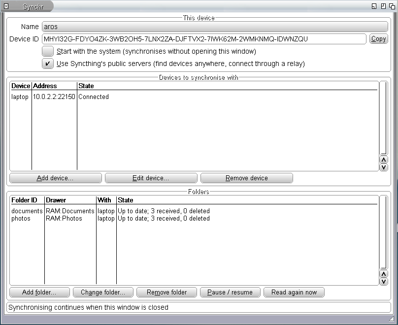

# Synchr

Synchr keeps files on your AROS computer the same as on your other
computers and your phone. Put a file in a drawer on AROS and it appears
in a folder on your PC; change it on the PC and the change comes back to
AROS. It works with Syncthing, so the other side can be Windows, macOS,
Linux or Android.



## What is Syncthing?

[Syncthing](https://syncthing.net) is a free, open-source program that
keeps folders the same on several devices. The devices talk to each other
directly; your files are not stored on anyone's server and there is no
account to create. Each device has a Device ID, a long code that the
devices use to recognise each other, and you choose which folders each
device gets.

Syncthing itself does not run on AROS. Synchr is a separate program for
AROS that speaks Syncthing's protocol, so to your other devices your AROS
computer looks like one more Syncthing device. On the other computers you
use the ordinary Syncthing. Synchr is not made by the Syncthing project.

## What you can do with it

- Work on a document on AROS and find it on your PC, or the other way
  round.
- Keep a copy of your AROS work on another computer, updated as you go.
- Bring photos or music from a phone that runs Syncthing to AROS.

Synchr copies new, changed and deleted files in both directions. If the
same file was changed on both sides before they met, nothing is lost: the
other version is kept next to it as a conflict copy.

The other computer does not have to be on the same network. Synchr finds
it through Syncthing's public servers, as Syncthing does, and when a
router stands in the way the connection goes through one of Syncthing's
relays. The devices check each other's Device ID and everything between
them is encrypted, so a relay cannot read your files.

Synchr keeps working when you close its window, and it can start with the
system.

## Getting started

1. Install Syncthing on your other computer or phone if it is not there
   yet ([downloads](https://syncthing.net/downloads/)).
2. Install Synchr on AROS (below) and double-click it. The window shows
   your AROS computer's Device ID.
3. In Synchr, Add device: paste the other computer's Device ID (in
   Syncthing: Actions, Show ID). Syncthing on the other side asks whether
   to accept the new device; accept it.
4. In Syncthing, share a folder with the AROS device. In Synchr, Add
   folder: the same folder ID and the drawer on AROS that should hold it.

The ReadMe in the Synchr drawer goes through the same steps in more
detail.

## Installation

With apkg:

```
apkg install synchr
```

Or download the archive for your system from the
[releases](https://github.com/tomaszstaniak/aros-synchr/releases), unpack
it anywhere and double-click Synchr.

| System | Archive |
|---|---|
| ABIv11 distributions, x86_64 PC | `Synchr-<version>-aros-x86_64-abiv11-pc.zip` |
| Mainline AROS x86_64 (ABIv1), a nightly from 2026-11-06 or later | `Synchr-<version>-aros-x86_64-abiv1-pc.zip` |
| Raspberry Pi (AArch64, ABIv1) | `Synchr-<version>-aros-aarch64-abiv1-raspi.zip` |

The archives are not interchangeable. Synchr needs a working network
connection on AROS.

## Good to know

- Try it with a test folder first. Synchronising works both ways:
  deleting a file on one side deletes it on the other.
- A folder is kept in step with one other device for now.
- IPv6 and automatic port opening on routers (UPnP) are not supported
  yet. Without them, connections between different networks go through a
  relay, which works but is slower.
- File names with letters outside ASCII have not been tested yet.
- Known issue: on AROS in QEMU with the e1000 network card, the whole
  system can stop while Synchr is transferring. The rtl8139 card works.
  Please report it if you see this on a real computer.

## Support and feedback

Reports, ideas and support for further work are welcome at
[Patreon](https://www.patreon.com/reperspective) and
[Ko-fi](https://ko-fi.com/enbewu).

## Building from source

Synchr is written in C, with a Zune window and OpenSSL for the encrypted
connections. Building and testing are described in
[docs/development.md](docs/development.md).

## Licence

MIT (see `LICENSE`). Two files derived from Syncthing are under the
Mozilla Public License 2.0, and the AROS programs include OpenSSL and
jitterentropy: see `NOTICE`.
